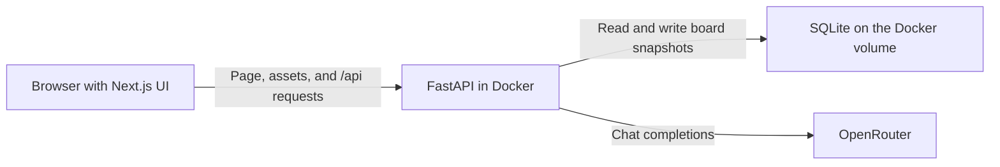

# Architecture and application flows

The browser uses one origin for the page and API. The Docker build exports Next.js to static files. A slim Python image installs pinned dependencies through `uv`, copies in the export, and starts Uvicorn. FastAPI serves the static site at `/` and registers its API routes before mounting the static files.

## Ownership by file

| File | Responsibility |
| --- | --- |
| [Dockerfile](../Dockerfile) and [compose.yaml](../compose.yaml) | Image build, runtime service, host port, health check, and named data volume |
| [backend/main.py](../backend/main.py) | Startup lifecycle, session cookie, HTTP routes, and static hosting |
| [backend/board.py](../backend/board.py) | Board validation, database setup, and revision-checked writes |
| [backend/ai.py](../backend/ai.py) | OpenRouter client, structured response schema, and application of card operations |
| [Workspace.tsx](../frontend/src/components/Workspace.tsx) | Session state, API calls, pending saves, and conversation history |
| [KanbanBoard.tsx](../frontend/src/components/KanbanBoard.tsx) and [kanban.ts](../frontend/src/lib/kanban.ts) | Board interactions, drag handlers, and card ordering logic |
| [ChatSidebar.tsx](../frontend/src/components/ChatSidebar.tsx) | Chat input, transcript, and provider error feedback |

## Sign-in and board load

FastAPI checks the demo credentials and writes the user's ID to a signed, HTTP-only cookie. The frontend checks `GET /api/session` on load and fetches `GET /api/board` for a signed-in user. The board and chat routes derive the user ID from the cookie.

## Manual saves and dragging

The frontend sends a complete board snapshot and its current revision to `PUT /api/board`. While a save is in progress, the workspace blocks additional writes and chat requests. SQLite increments the revision on a successful write.

During drag, the source card stays in the layout as an invisible placeholder and a preview follows the pointer. On drop, the UI shows the card in its new position immediately while the request is pending. A failed save falls back to the previously saved board, and a revision conflict fetches the latest server snapshot.

## Assistant chat

`POST /api/chat` loads the latest board, then sends that board, the new message, and the browser's conversation history to OpenRouter using `openai/gpt-oss-120b`. The response schema requires a reply and separate lists of create, edit, and move operations. A reply with empty lists leaves the board as it was.

Python applies the proposed operations to a copy and validates the result before saving. The write checks the revision read before the model call, so a newer edit made while the model is responding takes precedence. The response includes the new snapshot when a change was saved, and the UI renders it automatically.

The provider receives board content and conversation history when you use chat. The key stays in the backend. The transcript lives in browser memory and clears on reload or sign-out.
